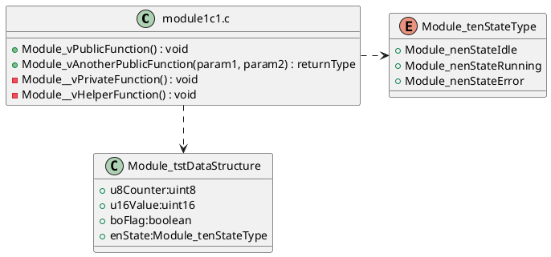
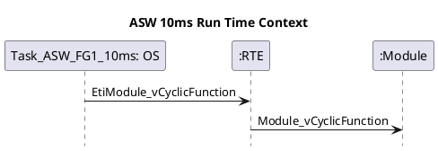
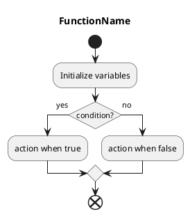
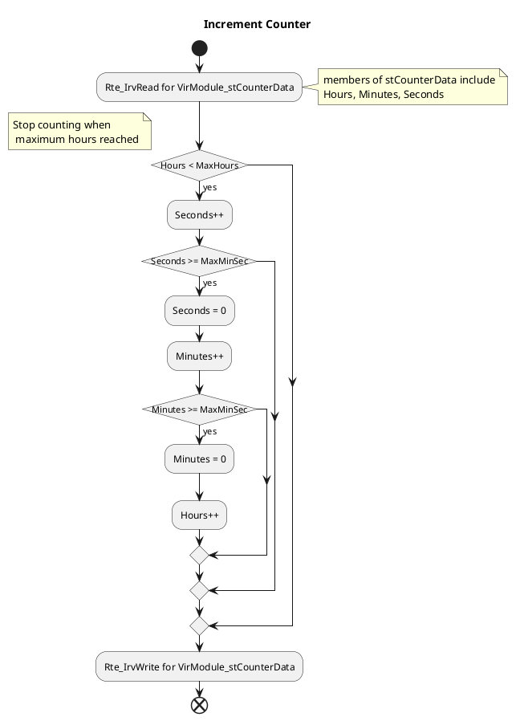
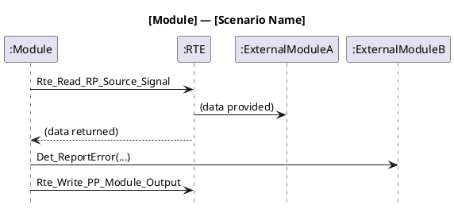

# PlantUML Diagram Creation Skill

This skill helps create professional PlantUML diagrams for automotive embedded software documentation, following AUTOSAR standards and automotive industry best practices.

## When to Use This Skill

Use this skill when:
- Creating Doxygen documentation for automotive modules
- Generating class diagrams for C source files
- Creating sequence diagrams for runtime contexts
- Documenting function logic with activity diagrams
- Showing component dependencies and interfaces
- Creating use case diagrams for module functionality
- Following automotive software documentation standards

## Project Structure Overview

### Folder Structure: [Module Path]

A typical module folder structure:

```
[Module Path]/
├── core/         # Source code and headers for the module
├── doc/          # Documentation (Doxygen sources, images, generated docs)
│   ├── dox/      # Doxygen .dox files (chapter-based documentation)
│   ├── images/   # Images for documentation
│   └── ms/       # Generated HTML and other output
├── test/         # Unit and integration tests
├── [module]_pf.yml   # Module configuration file
```

### Module File Structure: [Module Path]/core

Typical C module structure (may include multiple .c files):

```
[Module Path]/core/
├── [module]1c1.c       - Main implementation file 1
├── [module]1c2.c       - Main implementation file 2 (if exists)
├── [module]1c1.h       - Public interface header
├── [module]1ci.h       - Internal interface header
├── [module]1ca.h       - Adaptation interface header
└── [module]type.h      - Type definitions
```

## Documentation Structure

### File Structure and Description: [Module Path]/doc/dox

This folder contains Doxygen documentation source files. Each file represents a chapter or section in the generated documentation, following a modular and traceable structure:

| **File Name**                                | **Description**                                                                 |
|----------------------------------------------|---------------------------------------------------------------------------------|
| [module]_1_mainpage.dox                      | Main page: Entry point, author, version, and links to all chapters.            |
| [module]_2_history.dox                       | History: Versioning and change history, managed via git.                       |
| [module]_3_terms_and_abbreviations.dox       | Terms & Abbreviations: Glossary for terms and abbreviations used.              |
| [module]_4_overview.dox                      | Overview: Module description, responsibilities, and input/output diagrams.      |
| [module]_5_export_interface.dox              | Export Interface: Public API, static view, functions, variables, and macros.    |
| [module]_6_integration.dox                   | Integration: System integration, runtime contexts, configuration, and switches. |
| [module]_7_internal_design.dox               | Internal Design: Internal structure, static view, and internal functions.       |
| [module]_8_open_issues.dox                   | Open Issues: List of current open issues (if any).                              |
| [module]_9_references.dox                    | References: Reference documents and Doxygen usage examples.                     |
| [module]_10_traceability.dox                 | Traceability: Requirement traceability, ID conventions, and linking guidance.   |

### Diagram Placement Guidelines

| Chapter | Section | Diagrams |
|---------|---------|----------|
| Chapter 4 (Overview) | 4.x | Component/Port diagrams, Use Case diagrams, Component dependencies |
| Chapter 5 (Export Interface) | 5.1 | Interface diagram (public API — static view) |
| Chapter 5 (Export Interface) | 5.1.1 | Activity diagrams for each **exported (public)** function |
| Chapter 5 (Export Interface) | 5.2 | Inter-module Sequence diagrams (Dynamic View: module-to-module scenarios) |
| Chapter 6 (Integration) | 6.x | Sequence diagrams (Runtime Context: OS Task → RTE → API) |
| Chapter 7 (Internal Design) | 7.1 | Class diagram (Static View: all functions, structs, enums) |
| Chapter 7 (Internal Design) | 7.1.1 | Activity diagrams for each **internal (private)** function |
| Chapter 7 (Internal Design) | 7.2 | Internal Dynamic View (call-flow between private functions, intra-module only) |

## General Formatting Rules

### Document Structure
```doxygen
/**
\page chapter7 Internal Design

\tableofcontents

\section c7_static_view 7.1 Static View

@startuml
' Diagram content
@enduml

<br>

@startuml
' Another diagram
@enduml

\reftrace{MS_MODULE_XX}

*/
```

### Configuration Blocks
```plantuml
''Config
hide footbox
autoactivate off
```

### Title Convention
```plantuml
title **Title Text in Bold**
```

## Class Diagrams (Static View)

### Purpose
- Show internal module structure
- Display classes, structs, enums
- Document functions and data types
- Used in Chapter 7 (Internal Design)

### For C Implementation Files



### Naming Conventions

**Functions:**
- Public: `+Module_vFunctionName()` (+ prefix)
- Private: `-Module__vHelperFunction()` (- prefix, double underscore)
- Return type: `: returnType` after function name

**Data Members:**
- Format: `memberName:type`
- Prefixes:
  - `bo`: boolean
  - `u8`: uint8
  - `u16`: uint16
  - `u32`: uint32
  - `en`: enum
  - `st`: struct
  - `au`: array

### Relationship Patterns

```plantuml
classA .left.> classB     ' Dependency, points left
classA .right.> classB    ' Dependency, points right
classA .up.> classB       ' Dependency, points up
classA .down.> classB     ' Dependency, points down
classA ..> classB         ' Dependency, no direction
classA --> classB         ' Association (solid arrow)
classA .[hidden]right.> classB  ' Hidden (for layout)
```

## Sequence Diagrams (Runtime Context)

### Purpose
- Document function call flows
- Show OS Task → RTE → API interactions
- Display timing/data/mode switch events
- Used in Chapter 6 (Integration)

### Standard Template



### Event Types and Grouping

**Mode Switch Events:**
```plantuml
taskaswmode -> Rte : EmsModule_FunctionInit
Rte -> Api         : Module_vFunctionInit
====
taskaswmode -> Rte : EmsModule_FunctionDeinit
Rte -> Api         : Module_vFunctionDeinit
```

**Data Received Events (Grouped):**
```plantuml
group Data Events
    taskname -> Rte    : EdrModule_vDataHandler
    Rte -> Api         : Module_vDataHandler
    ====
    taskname -> Rte    : EdrModule_vAnotherHandler
    Rte -> Api         : Module_vAnotherHandler
end group
```

**External Trigger Events:**
```plantuml
group External Trigger Events
    taskname -> Rte    : EetModule_TimeoutEvent
    Rte -> Api         : Module_vHandleTimeout
    ====
    taskname -> Rte    : EetModule_AnotherTimeout
    Rte -> Api         : Module_vHandleAnotherTimeout
end group
```

**Timing Events:**
```plantuml
taskname -> Rte  : EtiModule_vCyclicFunction
Rte -> Api       : Module_vCyclicFunction
```

### Event Naming Conventions

- **Mode Switch**: `Ems` + ModuleName + Function (e.g., `EmsModule_Init`)
- **Data Received**: `Edr` + ModuleName + Handler (e.g., `EdrModule_vDataHandler`)
- **External Trigger**: `Eet` + ModuleName + Event (e.g., `EetModule_Timeout`)
- **Internal Trigger**: `Eit` + ModuleName + Handler (e.g., `EitModule_vExecute`)
- **Timing Event**: `Eti` + ModuleName + Cyclic (e.g., `EtiModule_vCyclic10ms`)

## Activity Diagrams (Dynamic View)

### Purpose
- Document function logic
- Show decision flows and loops
- Illustrate algorithms
- Used in Chapter 7 (Internal Design)

### Standard Template



### Basic Elements

**Simple Activity:**
```plantuml
:Activity description;
```

**Function Calls:**
```plantuml
:FunctionName()|
:Rte_IrvRead VirModule_stData(&stData)|
:Rte_IrvWrite_VirModule_stData(&stData)|
```

**Variable Operations:**
```plantuml
:variable = value;
:counter++;
:flag = TRUE;
```

### Decision Patterns

**Basic If-Then-Else:**
```plantuml
if (condition?) then (yes)
    :action when true;
else (no)
    :action when false;
endif
```

**With Notes:**
```plantuml
if (Hours < MaxHours) then (yes)
note right: Stop counting when \n maximum hours reached
    :Seconds++;
else (no)
    :Do nothing;
endif
```

**Switch Case:**
```plantuml
switch (variable?)
    case (value1)
        :action for value1;
    case (value2)
        :action for value2;
    case (default)
        :default action;
endswitch
```

### Loop Patterns

**While Loop:**
```plantuml
while (condition?)
    :loop body;
    :more actions;
endwhile
```

**While with Break:**
```plantuml
while (JobIndex < JobSize?)
    :process job;
    
    if (exit condition?) then (yes)
        break
    endif
endwhile
```

### Complete Example



## Inter-Module Sequence Diagrams (Chapter 5.2)

### Purpose
- Document how the module interacts with **external modules** during key scenarios
- Reveal the full call chain: internal function → RTE/service → external module
- Identify typical scenarios: initialization flow, error handling, NvM write sequence, DEM reporting, etc.
- Placed in **Chapter 5, Section 5.2 (Dynamic View)**

### How to Derive Scenarios from Code

Analyze the source code to identify meaningful interaction scenarios:

1. **Initialization scenario** — trace `Module_vInit()` and all calls it makes outward
2. **Main cyclic scenario** — trace `Module_vMainFunction()` and its external calls
3. **Error/fault scenario** — trace DET/DEM report paths (e.g., `Det_ReportError()`, `Dem_SetEventStatus()`)
4. **NvM scenario** — trace NvM read/write sequences (e.g., `NvM_WriteBlock()`, `NvM_GetErrorStatus()`)
5. **Signal output scenario** — trace how a result is published via RTE or SigCtl

### Standard Template



### Example — NvM Write Scenario

```plantuml
@startuml
title **Module — NvM Write Sequence**

''Config
hide footbox
autoactivate off

''Declaration
participant ":Module" as Mod
participant ":NvM" as NvM

''Sequence:
Mod -> NvM       : NvM_WriteBlock(blockId, dataPtr)
NvM --> Mod      : E_OK

loop poll until complete
    Mod -> NvM   : NvM_GetErrorStatus(blockId, &status)
    NvM --> Mod  : status
end

@enduml
```

### Example — DEM Error Reporting Scenario

```plantuml
@startuml
title **Module — DEM Fault Reporting**

''Config
hide footbox
autoactivate off

''Declaration
participant ":Module" as Mod
participant ":DEM" as Dem

''Sequence:
Mod -> Dem       : Dem_SetEventStatus(eventId, DEM_EVENT_STATUS_FAILED)
Dem --> Mod      : E_OK
====
Mod -> Dem       : Dem_SetEventStatus(eventId, DEM_EVENT_STATUS_PASSED)
Dem --> Mod      : E_OK

@enduml
```

### Scenario Identification Rules

| Code Pattern | Scenario to Document |
|---|---|
| `NvM_WriteBlock()` / `NvM_ReadBlock()` | NvM data persistence scenario |
| `Det_ReportError()` | DET error reporting scenario |
| `Dem_SetEventStatus()` | DEM fault reporting scenario |
| `SigCtl_*()` calls | Signal output scenario |
| `Rte_IrvRead/Write()` | Inter-runnable variable exchange scenario |
| Complex init sequence with multiple external calls | Initialization scenario |
| Mode-dependent external calls (switch/case over mode) | Mode transition scenario |

## Internal Dynamic View (Chapter 7.2)

### Purpose
- Document how **private functions interact with each other** within the module
- Reveal internal call chains, dispatch patterns, and pipeline flows
- Show intra-module control flow — **no external module participants**
- Placed in **Chapter 7, Section 7.2 (Dynamic View)**

### Preferred Diagram Type

**Activity/flowchart diagrams are preferred for all §7.2 scenarios.** They show call order, branching, and decision logic in a single compact view.

| Situation | Diagram type |
|---|---|
| Function dispatches to multiple private handlers (e.g., switch/state machine) | Activity with `switch/endswitch` |
| Private functions form a pipeline (A → B → C) | Activity with sequential steps |
| Branching over internal state or error class | Activity with `if/else` or `switch` |
| Cyclic entry point with fixed call sequence | Activity with sequential steps and `note right:` |

Sequence diagrams in §7.2 are only acceptable when parallel execution or timing between internal functions is essential to show.

### Standard Template — Internal Flowchart (Activity)

```plantuml
@startuml
title **[Module] — [Internal Call Chain Name]**
skinparam conditionStyle InsideDiamond

start
:Module_vMainFunction();
fork
    :TouchSM__vErrorHandling();
    :TouchSM__vConsolidateError();
    :TouchSM__vClassifyError();
    :TouchSM__vHandleErrorClass();
fork again
    :TouchSM__vProStMachine();
    switch (CurrOpMode?)
        case (TouchOff)
            :TouchSM__vProStTouchOff();
        case (TouchOn)
            :TouchSM__vProStTouchOperation();
        case (TcFlashUpdate)
            :TouchSM__vProStTcFlashUpdate();
    endswitch
end fork
stop
@enduml
```

### How to Derive Internal Scenarios from Code

Analyze the source for call patterns between private functions:

| Code Pattern | Scenario to Document |
|---|---|
| `switch(enCurrOpMode)` dispatching to private state handlers | State machine dispatch flow |
| Error function calling `Consolidate → Classify → Handle` | Error handling pipeline |
| Init function calling several setup helpers in sequence | Initialisation call chain |
| Multiple private helpers called in fixed order per cycle | Cyclic processing flow |
| Recursive or mutual calls between helpers | Recursive/cooperative call flow |

### Key Rules

- ✅ **Only** private/internal function names as participants
- ✅ Use `hide footbox` and `autoactivate off` for sequence diagrams
- ✅ Use `skinparam conditionStyle InsideDiamond` for activity diagrams
- ❌ Do NOT include external modules (RTE, TouchCD, DTC, etc.) — those belong in Ch5 §5.2
- ❌ Do NOT show individual activity logic (that belongs in §7.1.1 activity diagrams)

## Component/Port Diagrams

### Purpose
- Show module interfaces
- Display input/output ports
- Used in Chapter 4 (Overview)

```plantuml
@startuml
left to right direction

[Module]

rectangle "PsrModule_ServerN : IcsModule" {
  Module_StartTimer )-- [Module]
  Module_CancelTimer )-- [Module]
}

PdrModule_DataInA )--# [Module]

rectangle "ItrModule" {
  [Module]  --> Module__vTriggerEvent
}

[Module]  #--> PdsModule_DataOutX

@enduml
```

## Use Case Diagrams

### Purpose
- Show module use cases
- Display actors and interactions
- Used in Chapter 4 (Overview)

```plantuml
@startuml
left to right direction
skinparam packageStyle rectangle

actor Application
rectangle Module {
  Application -> (Start Timer)
  Application --> (Cancel Timer)
  Application --> (Handle Timeout)
}
@enduml
```

## Interface Diagrams

### Purpose
- Show public API
- Document exported functions
- Used in Chapter 5 (Export Interface)

```plantuml
@startuml
interface "module1c1.h" as interface
{
  Module_vInit():void
  Module_vMainFunction():void
  Module_vStartTimer(uint8, uint16):void
  Module_vCancelTimer(uint8):void
}
@enduml
```

## Automotive Naming Conventions

### Variable Prefixes
- `bo`: boolean (e.g., `boVideoOn`, `boTimerActive`)
- `u8`: unsigned 8-bit (e.g., `u8Counter`)
- `u16`: unsigned 16-bit (e.g., `u16TimerVal`)
- `u32`: unsigned 32-bit (e.g., `u32JobVal`)
- `en`: enumeration (e.g., `enJobStatus`)
- `st`: structure (e.g., `stJobRequest`)
- `au`: array (e.g., `au8Data`)

### Function Naming
- Public: `Module_vFunctionName()` or `Module_enFunctionName()`
- Private: `Module__vFunctionName()` (double underscore)
- Return type prefix:
  - `v`: void
  - `en`: enum
  - `bo`: boolean
  - `u8`, `u16`, `u32`: integer

### RTE Interface Patterns
```plantuml
:Rte_IrvRead VirModule_stData(&stData)|
:Rte_IrvWrite_VirModule_stData(&stData)|
:Rte_DRead_PortName_DataElement()|
:Rte_Call_PortName_Operation()|
```

## Best Practices

1. **Consistency**: Use same naming conventions throughout
2. **Clarity**: Add notes for complex logic
3. **Layout Control**: Use hidden relationships for better layout
4. **Grouping**: Group related events in sequence diagrams
5. **Modularity**: Keep diagrams focused on specific aspects
6. **Documentation**: Always add titles and proper markup
7. **Traceability**: Link to requirements using `\reftrace{}`
8. **Formatting**: Use bold for titles, consistent indentation

## Diagram Separation

Between multiple diagrams:
```doxygen
@enduml

<br>

@startuml
```

## Requirement Traceability

After diagrams:
```doxygen
@enduml

\reftrace{MS_MODULE_XX}
```

## Quick Reference Templates

### Empty Class Diagram
```plantuml
@startuml

class "filename.c" as alias
{
    +PublicFunction() : void
    -PrivateFunction() : void
}

class DataStructure
{
    +member:type
}

enum EnumType
{
    +Value1
    +Value2
}

alias ..> DataStructure
alias .right.> EnumType

@enduml
```

### Empty Sequence Diagram
```plantuml
@startuml
title **Task Name Run Time Context**

''Config
hide footbox
autoactivate off

''Declaration
participant "Task_Name : OS"  as taskname
participant ":RTE"  as Rte
participant ":Module" as Api

''Sequence:
taskname -> Rte : EventName
Rte -> Api      : FunctionName

@enduml
```

### Empty Activity Diagram
```plantuml
@startuml
title **FunctionName**
skinparam conditionStyle InsideDiamond

start

:Initialize variables;

if (condition?) then (yes)
    :action;
else (no)
    :alternative action;
endif

end
@enduml
```

## Version History
- **v1.0** - Initial version based on automotive software documentation patterns
- **v2.0** - Enhanced with folder structure and comprehensive file descriptions
- **v2.1** - Synchronized with PlantUML_Diagram_Guidelines.md latest updates

## References

- Full guideline: [PlantUML_Diagram_Guidelines.md](../../../ai4dev/PlantUML_Diagram_Guidelines.md)
- PlantUML Documentation: https://plantuml.com/
- Doxygen Documentation: https://www.doxygen.nl/

## Output Format

When creating diagrams, provide:
1. Complete PlantUML diagram code
2. Explanation of diagram structure
3. Guidance on which chapter to place it (refer to file structure table above)
4. Any necessary notes or annotations
5. Requirement traceability tags if applicable
